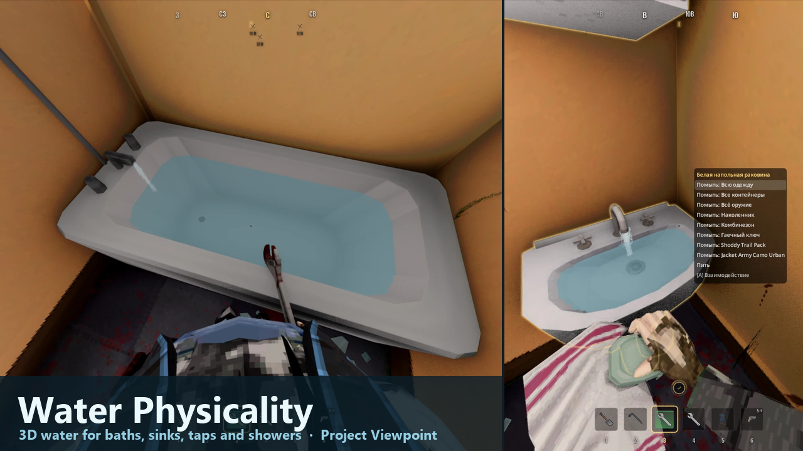
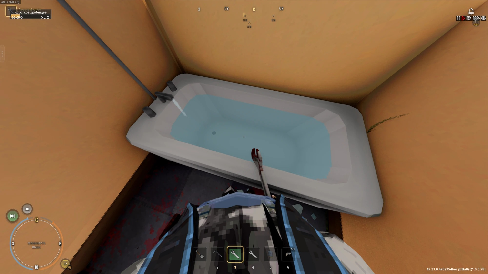
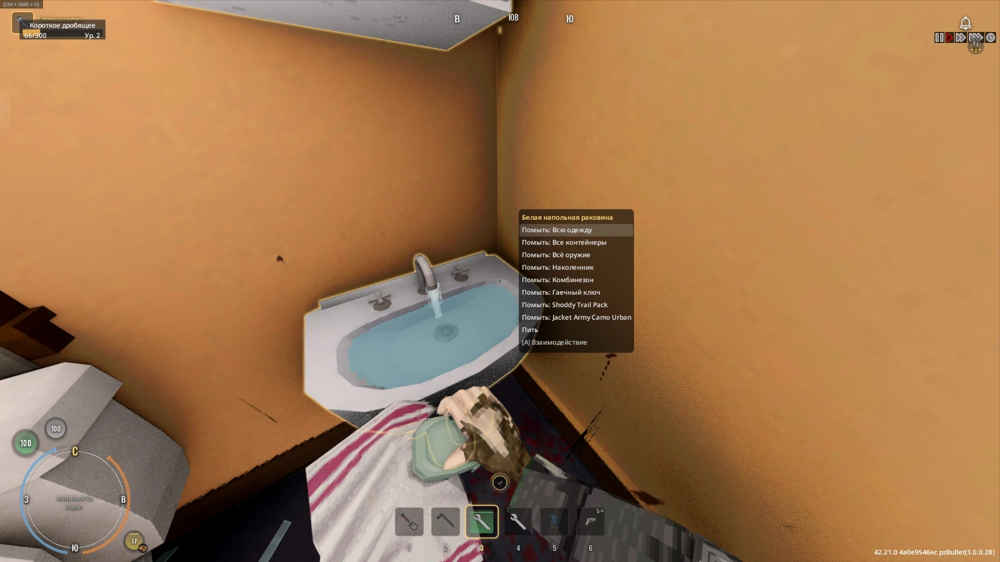

# Water Physicality

Water for sinks, bathtubs and showers in Project Zomboid (Build 42): real 3D water with Project Viewpoint, and the same water painted into the base game's isometric view without it.

| Tub filling with the tap running | Sink with the tap running |
|---|---|
|  |  |

**Steam Workshop:** https://steamcommunity.com/sharedfiles/filedetails/?id=3827710289

## What you get

- **Sinks** (kitchen, bathroom, pedestal, double and industrial sinks, and drinking fountains) get water and a tap stream while someone uses them: drinking, washing, filling a container. Each stream starts at the faucet's real spout; drinking fountains get an arcing jet from the bubbler.
- **Bathtubs** get water that rises and drains, and a stream from the tub tap while it runs.
- **Showers** get an animated spray from the shower head.
- **Isometric view:** the water and streams are painted into the fixture's own art, so they sort and fade with it and never spill over the rim or show through walls and mirrors.

## Two versions: enable one

| Version | Mod ID | What it does |
|---|---|---|
| Water Physicality - Viewpoint (3D + isometric) | `WaterPhysicality` | Both kinds of water: real 3D water and streams in Viewpoint's 3D view, and the painted water in the isometric view. Without Viewpoint it shows only the isometric water. Existing saves keep working with this one. |
| Water Physicality - Flat | `WaterPhysicalityFlat` | Only the isometric water. Lighter: no 3D models and no Java part. |

Both are in the same Workshop item. They cannot be enabled together.

## Requirements

**None.** Everything below is optional.

| Mod | What for | Link |
|---|---|---|
| Project Viewpoint | 3D water (Viewpoint version only) | https://steamcommunity.com/sharedfiles/filedetails/?id=3809306528 |
| ZombieBuddy | Loads the Viewpoint version's small Java part; asks you to approve it on first launch | https://steamcommunity.com/sharedfiles/filedetails/?id=3619862853 |
| 3D models for Viewpoint (sour_kisel) | Recommended with Viewpoint: the water is measured from its fixture models, so it fits them exactly | https://steamcommunity.com/sharedfiles/filedetails/?id=3810302175 |

## Works with

- **Lifestyle: Hobbies** (https://steamcommunity.com/sharedfiles/filedetails/?id=3403870858): water rises while the tub fills, stays while you bathe and drains afterwards, with Lifestyle's steam and bubbles drawn on top. The shower spray runs while you shower. Drinking or washing at a tub runs its tap.
- **Take A Bath And Shower [SP/MP]** (https://steamcommunity.com/sharedfiles/filedetails/?id=3592172476): tubs follow their real fill level and showers run. With both bath mods enabled, Take A Bath And Shower takes over bathing.
- **Neither:** sinks, tubs and showers show water and a stream while a normal water action (drinking, washing, filling a container) runs on them. Nothing fills up by itself, because the base game has no bathing.

Both bath mods are detected at runtime: nothing to configure.

## Multiplayer

- The server needs the mod: add Workshop ID `3827710289` and the Mod ID of the version you use (`WaterPhysicality` or `WaterPhysicalityFlat`).
- When a player uses a fixture, a tiny server relay tells the players nearby, so everyone sees the same water. It stores nothing and changes nothing in the world.
- The water itself is drawn by each player's game and is never sent to the server.

## Layout

- `Contents/mods/WaterPhysicality/`: the Viewpoint version (`common/` has the Lua, 3D models, isometric sprites and tile definitions; `42/` has the Java jar)
- `Contents/mods/WaterPhysicalityFlat/`: the Flat version (the same Lua and isometric sprites, no 3D models or Java)
- `workshop.txt`, `preview.png`, `screenshots/`: Workshop upload files
- `CHANGELOG.md`: every version's changes

Version 2.0.0.
