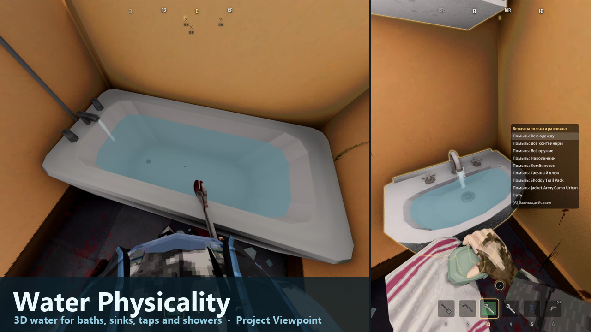
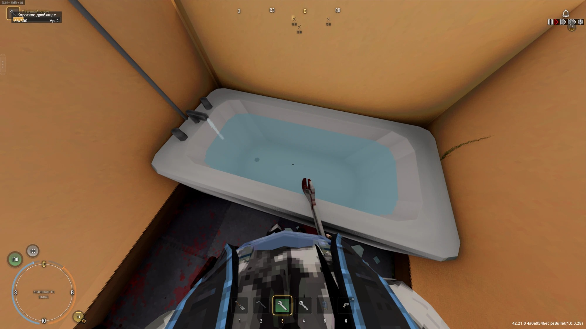
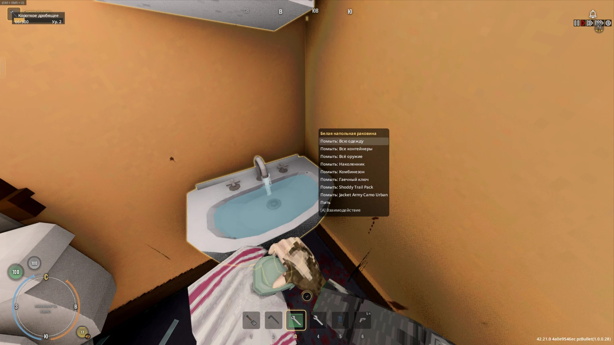

# Viewpoint - Water Physicality

Water in 3D for Project Zomboid (Build 42), drawn by Project Viewpoint.

| Tub filling with the tap running | Sink with the tap running |
|---|---|
|  |  |

**Steam Workshop:** https://steamcommunity.com/sharedfiles/filedetails/?id=3827710289

## What you get

- Bathtubs show real water that rises and drains. The waterline follows the tub's sloped walls.
- A stream runs from the tub tap while it fills.
- Sinks (kitchen, bathroom, pedestal and wall sinks) show water and a tap stream only while you use them.
- Showers get an animated spray from the shower head.

## Required Workshop items

| Mod | Link |
|---|---|
| Project Viewpoint | https://steamcommunity.com/sharedfiles/filedetails/?id=3809306528 |
| ZombieBuddy (the mod ships a small Java part that ZombieBuddy asks you to approve) | https://steamcommunity.com/sharedfiles/filedetails/?id=3619862853 |

## Recommended, for full functionality

They add bathing, so tubs fill and drain and showers run. Either one works, and both together work too (Take A Bath And Shower then takes over bathing).

| Mod | Link |
|---|---|
| Take A Bath And Shower [SP/MP] | https://steamcommunity.com/sharedfiles/filedetails/?id=3592172476 |
| Lifestyle: Hobbies | https://steamcommunity.com/sharedfiles/filedetails/?id=3403870858 |
| 3D models for Viewpoint (sour_kisel). The water is measured from its fixture models, so it fits them exactly. | https://steamcommunity.com/sharedfiles/filedetails/?id=3810302175 |

Without a bath mod the mod still works: fixtures show water and a stream while a normal water action (washing, filling a container, drinking) runs on them. Nothing fills up by itself, because the base game has no bathing.

## Multiplayer

The server must have the mod enabled (add the Workshop ID `3827710289` and the Mod ID `WaterPhysicality` to its mod list). A small server relay passes along which fixture a player is using, so everyone sees the same water. It stores nothing and changes nothing in the world.

## Layout

- `Contents/mods/WaterPhysicality/`: the mod (`common/` has the Lua, model pack and tiles; `42/` has the Java jar)
- `workshop.txt`, `preview.png`, `screenshots/`: Workshop upload files

Version 2.0.0. The Lifestyle: Hobbies and vanilla-only modes are new and not yet tested with every setup.
